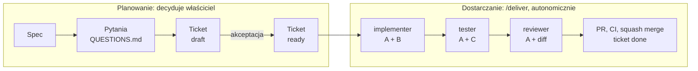

# Jak działa trybik-engine

Szczegóły dla ciekawych i dla tych, którzy chcą zmieniać proces. Do samego używania wystarczy [README](README.md).

## Przepływ pracy



Ticket `ready` to zgoda właściciela na całą pracę w jego zakresie. Od tej chwili agent pracuje sam i zatrzymuje się tylko w sytuacjach STOP (niżej).

## Ticket

Nagłówek ticketu (front-matter) to jedyne miejsce, w którym zapisany jest status pracy. `docs/BACKLOG.md` jest z niego generowany.

```yaml
---
id: T-012
title: Logowanie e-mailem
status: ready            # draft | ready | in-progress | done | dropped
rank: 20                 # niższy = wcześniej
depends: T-001
spec: docs/specs/logowanie.md
kind: logic              # logic = testy i review; plain = docs, config, chore
allow: src/auth/**, tests/auth/**
---
```

Treść ma trzy warstwy:

| Warstwa | Zawartość | Kto czyta |
|---|---|---|
| **A. Produkt** | cel, zakres In/Out, decyzje, kryteria `AC1…ACn` | wszyscy; warstwa nadrzędna |
| **B. Implementacja** | kontekst do przeczytania, artefakty, zachowanie, ograniczenia, docs do aktualizacji | implementer |
| **C. Weryfikacja** | scenariusze oznaczone `[ACn]`, struktura testów, anty-wzorce | tester |

- Każde kryterium akceptacji musi mieć scenariusz w warstwie C. Pilnuje tego `docs_check.py`.
- Ticket mieści się w ok. 10 plikach i 100 liniach zmian. Większy dzielisz na pionowe wycinki.
- Cykl życia: `draft → ready → in-progress → done` (albo `dropped`). Status zmienia się w tym samym PR co kod.
- Ticket nie może być `ready`, dopóki blokuje go otwarte pytanie w `QUESTIONS.md` (pole `blokuje:`).

## Role agentów

Sesja główna przekazuje subagentowi tylko jego część ticketu (`ticket_parts.py`). Izolację wymusza więc mechanizm, a nie prośba w prompcie.

| Agent | Model | Dostaje | Nie dostaje |
|---|---|---|---|
| `implementer` | Sonnet | A + B | C, katalog `docs/tickets/` |
| `tester` | Sonnet | A (cel, zakres, akceptacja) + C + lista zmienionych plików | B |
| `reviewer` | Opus | A (cel, zakres, akceptacja) + diff + „Docs do aktualizacji” | B, C |

Tester nie wie, jak zaimplementowano zmianę, więc testy sprawdzają zachowanie, a nie odbijają kod. Tickety `kind: plain` (dokumentacja, konfiguracja, layout) pomijają testera i review.

Jeśli w Claude Code jest dostępny `/advisor`, implementer konsultuje z mocniejszym modelem trudne decyzje. Bez niego raport kończy się `Advisor: niedostępny`.

### Kiedy agent się zatrzymuje (STOP)

Gdy warstwa A jest niejednoznaczna albo dwa dokumenty się wykluczają, gdy potrzebna jest praca poza zakresem lub `allow`, gdy poprawka po review albo testach nie przechodzi po pierwszej próbie, i przed nową decyzją trudną do odwrócenia (wtedy najpierw powstaje ADR). Szczegóły: [`docs/runbooks/delivery.md`](template/docs/runbooks/delivery.md).

## Bramki jakości

| Automat | Co wymusza |
|---|---|
| Hook `SessionStart` (`py.sh --session`) | Na starcie sesji wykrywa Pythona (`python3`, `python` albo `py -3`, ≥ 3.8) i podaje agentowi właściwą komendę. Brak Pythona → widoczny błąd. |
| Hook `Stop` (`stop_check.py`) | Przed zakończeniem odpowiedzi agenta uruchamia `docs_check`. Błędy (poza szkicami) wracają do agenta, najwyżej raz na turę. |
| Hook git (`guard_git.py`) | Blokuje commit, lokalne scalanie, przepisywanie historii i push na `main`/`master` (poza pierwszym commitem) oraz force push, także przez `+refspec`, `cd` albo `git -C`. Wpuszcza `gh pr merge` tylko po zielonym CI na GitHubie albo po lokalnym `tools/ci.sh` dla tego samego commita. |
| Scope guard (`scope_guard.py`) | Agent `implementer` zapisuje (Edit/Write) tylko pliki z `allow` ticketu i nie czyta (Read) `docs/tickets/`. |
| Uprawnienia (`settings.json`) | `.env`, `.env.local` i podobne są niedostępne dla Read (Bash `cat` to omija), `BACKLOG.md` zmienia się tylko przez `--write`, a `rm -rf`/`-fr`/`-r`, `git reset --hard` i `git clean` wymagają potwierdzenia. |
| `docs_check.py` | Sprawdza pola i statusy ticketów, zależności, pokrycie kryteriów scenariuszami, blokujące pytania, limit `STATE.md` i aktualność `BACKLOG.md`. |

**Automaty to barierki dla agenta, a nie zabezpieczenie.** Agent, który chce je obejść (Bash, aliasy, skrypty), da radę. Ochronę gałęzi po stronie GitHuba (reguły, wymagany PR) ustawiasz w projekcie sam, jeśli plan na to pozwala.

## CI

- **`tools/ci.sh`** jest jedynym miejscem z komendami sprawdzającymi. Na start uruchamia walidację dokumentacji, a testy, lint i typy dopisuje T-001. To samo uruchamia się lokalnie i na GitHubie.
- **`.github/workflows/ci.yml`** tylko przygotowuje środowisko i woła `tools/ci.sh` na każdym PR. Przy samej dokumentacji skrypt pomija testy, lint i typy (ok. 1 minuta).
- **Gdy GitHub nie uruchomi testów** (brak minut), agent uruchamia `bash tools/ci.sh` lokalnie, a wynik zapisuje się dla tego commita. Automat git przepuszcza `gh pr merge` po zielonym CI na GitHubie albo po lokalnym przejściu tego samego commita. Błąd testów na GitHubie blokuje zawsze. Lokalny wynik (`.git/ci-passed`) to deklaracja agenta, a nie dowód.

## Struktura projektu po instalacji

```text
twoj-projekt/
├── CLAUDE.md                    # wejście dla agenta: start sesji, komendy, zasady
├── .claude/
│   ├── settings.json            # hooki i uprawnienia
│   ├── hooks/                   # py.sh, stop_check, guard_git, scope_guard
│   ├── agents/                  # implementer, tester, reviewer
│   └── skills/                  # /deliver, /ticket
├── docs/
│   ├── PROCESS.md               # proces, mapa dokumentów, Definition of Done
│   ├── STATE.md                 # stan bieżący (≤ 40 linii)
│   ├── BACKLOG.md               # generowany z ticketów, nie edytuj ręcznie
│   ├── QUESTIONS.md             # pytania do właściciela z polem `blokuje:`
│   ├── journal.md               # pomysły przed decyzją
│   ├── product/                 # wizja, zakres MVP, słownik pojęć
│   ├── specs/                   # docelowe zachowanie funkcji (żywe)
│   ├── adr/                     # decyzje architektoniczne (niezmienne)
│   ├── architecture/            # moduły, konwencje, testy
│   ├── tickets/                 # T-NNN-slug.md, jedyne źródło statusu
│   ├── reviews/                 # wnioski z przeglądów z rozstrzygnięciem
│   ├── runbooks/                # kickoff, adoption, delivery
│   ├── templates/               # spec, ticket, ADR, architektura, produkt
│   └── sources/                 # materiały zastane (opcjonalnie, tylko do odczytu)
├── tools/
│   ├── docs_check.py            # walidacja, backlog, kolejny ticket, nowe szkice
│   └── ci.sh                    # pełne sprawdzenie (lokalnie i w CI)
└── .github/workflows/ci.yml     # uruchamia tools/ci.sh na każdym PR
```

## Zasady projektowe

trybik-engine powstał przy pracy nad aplikacją rozwijaną z agentami AI. Każda reguła odpowiada na problem, który wyszedł w praktyce, a tam, gdzie się dało, reguła opisana prozą stała się automatem.

| Problem | Rozwiązanie w trybik-engine |
|---|---|
| Status pracy zapisany w kilku miejscach się rozjeżdża, a osobne PR-y „docs: done” zaśmiecają historię. | Status jest tylko we front-matter ticketu, `BACKLOG.md` jest generowany, a `done` trafia do tego samego PR co kod. |
| Pytania są rozproszone i mieszają decyzje, fakty, bezpieczeństwo oraz wnioski z review. | Jest jeden `QUESTIONS.md` z pytaniami produktowymi, a pytanie z `blokuje:` wstrzymuje ticket. Wnioski z review trafiają do `docs/reviews/` z rozstrzygnięciem. |
| Plik stanu puchnie i powiela specyfikacje. | `STATE.md` ma limit 40 linii i nie opisuje działania funkcji. |
| Nie wiadomo, co jest aktualne: spec czy ticket. | Spec jest żywy, a ticket historyczny. Reviewer sprawdza listę „Docs do aktualizacji”. |
| Zakres pracy jest opisany tylko prozą. | Pole `allow` we front-matter i hook scope guard. |
| Kolejność to „pierwszy niezaznaczony”. | `rank` i `depends`, a `--next` wybiera pierwszy odblokowany ticket. |
| Brakuje śladu od kryterium do testu. | Kryteria są numerowane, narzędzie wymaga ich pokrycia w C, a nazwa testu zawiera `T-NNN.ACn`. |
| Testy są dopasowane do implementacji. | Tester nie widzi warstwy B. |
| PR zostaje scalony mimo czerwonego CI, bo GitHub nie uruchomił testów (limit minut). | Automat git sprawdza CI przed `gh pr merge`, a gdy GitHub nic nie uruchomił, wymaga lokalnego `tools/ci.sh`. |
| Agent może zignorować regułę zapisaną tylko jako tekst. | Hooki, uprawnienia, `docs_check.py` i CI. Kolejne pomysły są w [`AUTOMATION-PROPOSALS.md`](AUTOMATION-PROPOSALS.md). |

## Roadmapa

Wdrożone: hooki `SessionStart` (wykrywanie Pythona), `Stop` i git, scope guard, agenci `implementer`, `tester` i `reviewer`, skille `/deliver` i `/ticket`, CI z lokalnym zapasem. W planach:

- [ ] Hook `SessionStart`: na starcie sesji wstrzykuje też stan projektu i kolejny ticket.
- [ ] Hook `PostToolUse`: lint i formatowanie po każdej edycji.
- [ ] Hook ograniczający testera do zapisu w katalogu testów.
- [ ] Skill `/triage-review`: każde znalezisko z przeglądu dostaje rozstrzygnięcie.
- [ ] Jakość testów: mutation testing, testy property-based i sprawdzanie, że każde kryterium akceptacji ma test, a nie tylko scenariusz.
- [ ] Równoległe dostarczanie niezależnych ticketów w osobnych git worktree.
- [ ] Krok „uruchom i zobacz” przed merge dla zmian w UI i CLI.
- [ ] Pętla uczenia: błędy powtarzające się w review zamieniane na reguły lintera lub hooka.

Szczegóły i uzasadnienia: [`AUTOMATION-PROPOSALS.md`](AUTOMATION-PROPOSALS.md).
