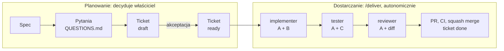

<div align="center">

# ⚙️ trybik-engine

**Proces dostarczania oprogramowania z agentami AI, w którym reguł pilnuje kod, a nie dobra wola modelu.**

[](https://www.python.org/)
[](#wymagania)
[](https://claude.com/claude-code)
[](LICENSE)

[Szybki start](#szybki-start) · [Jak to działa](#jak-to-działa) · [Bramki jakości](#bramki-jakości) · [Dokumentacja](#dokumentacja)

</div>

---

**trybik-engine** to neutralny technologicznie szablon procesu dla [Claude Code](https://claude.com/claude-code). Instalujesz go w repozytorium, nowym albo istniejącym, a agent prowadzi pracę od wizji produktu przez specyfikacje i tickety po implementację, testy, review i merge. Pracuje w małych, sprawdzalnych krokach. Decyzje produktowe zostają po stronie właściciela.

```text
spec → pytania → ticket A/B/C → implementacja → testy → review → PR → CI → merge
```

trybik-engine jest efektem iteracyjnej pracy nad aplikacją rozwijaną z agentami AI i workflow wypracowanego przy tej pracy. Każda reguła odpowiada na problem, który wyszedł w praktyce, a tam, gdzie się dało, reguła opisana prozą stała się automatem.

## Spis treści

- [Najważniejsze cechy](#najważniejsze-cechy)
- [Wymagania](#wymagania)
- [Szybki start](#szybki-start)
- [Codzienna praca](#codzienna-praca)
- [Jak to działa](#jak-to-działa)
- [Bramki jakości](#bramki-jakości)
- [CI](#ci)
- [Struktura](#struktura)
- [Zasady projektowe](#zasady-projektowe)
- [FAQ](#faq)
- [Roadmapa](#roadmapa)
- [Dokumentacja](#dokumentacja)
- [Współtworzenie](#współtworzenie)
- [Licencja](#licencja)

## Najważniejsze cechy

- **Każdy fakt ma jedno miejsce.** Status pracy żyje tylko we front-matter ticketu, a `BACKLOG.md` jest z niego generowany. Spec opisuje aktualne zachowanie, ticket jest zapisem historycznym.
- **Reguły egzekwowane, nie tylko opisane.** Hooki Claude Code blokują commit na `main`, force push, merge bez zielonego CI, zapis poza zakresem ticketu i ręczną edycję plików generowanych.
- **Izolacja ról.** Implementator nie widzi scenariuszy testowych. Tester nie wie, jak zaimplementowano zmianę, więc testy sprawdzają zachowanie, a nie odbijają kod. Reviewer ocenia diff względem wymagań.
- **Ticket w trzech warstwach.** A: co i dlaczego. B: jak. C: weryfikacja. Kryteria akceptacji są numerowane, a narzędzie wymaga, żeby każde było pokryte scenariuszem.
- **Właściciel decyduje, agent wykonuje.** Ticket przechodzi z `draft` do `ready` tylko po akceptacji właściciela i nie może być `ready`, dopóki blokuje go otwarte pytanie.
- **Autonomia w granicach zakresu.** Ticket `ready` to zgoda na całą pracę w jego zakresie. Agent zatrzymuje się tylko w zdefiniowanych sytuacjach STOP.
- **Zero zależności.** Narzędzia procesu potrzebują tylko Pythona ≥ 3.8 (biblioteka standardowa) i gita. Stos projektu wybierasz sam (ADR-0001).
- **Oszczędność minut CI.** PR z samą dokumentacją nie uruchamia CI na GitHubie. Gdy GitHub nie uruchomi testów, ten sam skrypt przechodzi lokalnie, a automat git to weryfikuje.

## Wymagania

| Narzędzie | Do czego |
|---|---|
| [Claude Code](https://claude.com/claude-code) | prowadzi proces: hooki, subagenci, skille |
| Python ≥ 3.8 | instalator i `tools/docs_check.py`, tylko biblioteka standardowa |
| git | branche, commity, historia ticketów |
| [GitHub CLI](https://cli.github.com/) (`gh`) | PR-y, status CI, squash merge |

## Szybki start

```bash
git clone https://github.com/przemenZ/trybik-engine.git
cd trybik-engine
```

Dalej wybierz scenariusz poniżej. Instalator kopiuje do projektu zawartość katalogu `template/` (`CLAUDE.md`, `docs/`, `tools/`, `.claude/`, `.github/`, `.gitignore`, `.env.example`). Reszta repozytorium (README, testy, `install.py`) to sam trybik-engine i zostaje na miejscu.

### Nowy projekt

Pusty katalog, start od zera:

```bash
python3 install.py ../nowy-projekt
cd ../nowy-projekt
# wpisz nazwę projektu w pierwszej linii CLAUDE.md
git init -b main
git add -A && git commit -m "chore: trybik-engine"
gh repo create nowy-projekt --private --source=. --push
```

Następnie w Claude Code napisz **„zacznij projekt”**. Agent poprowadzi [`docs/runbooks/kickoff.md`](template/docs/runbooks/kickoff.md):

> wizja → stos (ADR-0001) → architektura → spece funkcji → T-001 szkielet aplikacji → tickety funkcji

Każdy krok kończy się Twoją akceptacją.

### Istniejący projekt

Legacy, zaczątek aplikacji albo zbiór dokumentów. Kod zostaje tam, gdzie jest: instalator niczego nie przenosi, tylko dokłada obok pliki procesu. Instalator nic o projekcie nie wie. Projekt poznaje agent po komendzie „przejmij projekt”: opisuje to, co zastał, krok po kroku, a każdy krok czeka na Twoją akceptację.

1. W projekcie wszystko jest zacommitowane, potem `git switch -c docs/adoption`.
2. Z katalogu trybik-engine uruchom `python3 install.py ../projekt`.
3. Dokumenty projektu spoza repo (notatki, PDF, docx) skopiuj do `docs/sources/`. Tylko dokumenty, nie kod. Wpisz nazwę projektu w `CLAUDE.md`.
4. W Claude Code napisz **„przejmij projekt”**. Agent poprowadzi [`docs/runbooks/adoption.md`](template/docs/runbooks/adoption.md):

> inwentaryzacja → wizja → stos → architektura z kodu → T-001 podpięcie procesu (komendy, CI) → tickety

Instalator niczego nie nadpisuje:

| Sytuacja w projekcie | Zachowanie instalatora |
|---|---|
| brak pliku | kopiuje |
| plik identyczny | pomija |
| inny `.gitignore` | dopisuje brakujące linie pod nagłówkiem `# trybik-engine` |
| własne `.env.example` lub workflow o tej samej nazwie | zostawia wersję projektu (workflow scala się w T-001) |
| inny plik o tej samej nazwie, np. `CLAUDE.md` | wersję projektu odkłada jako `CLAUDE.md.pre-kit`, a scala ją agent podczas adopcji |

Instalator odmawia pracy, gdy repo ma niezacommitowane zmiany, stoi na `main`/`master` (dotyczy repo z historią), zostały pliki `*.pre-kit` z poprzedniej instalacji albo celem jest katalog samego trybik-engine.

### Aktualizacja trybik-engine w projekcie

```bash
cd ../projekt && git switch -c chore/trybik-upgrade && cd -
git pull                                  # nowa wersja trybik-engine
python3 install.py --upgrade ../projekt
```

Aktualizacja zmienia tylko pliki kitu: hooki, skille, agentów, `docs_check.py`, szablony, runbooki i `PROCESS.md`. Plik, którego projekt nie zmieniał (zgodny z manifestem `.claude/trybik-engine.json`), jest nadpisywany. Plik zmieniony w projekcie trafia do `*.pre-kit` do scalenia. Pliki projektu (`CLAUDE.md`, `STATE.md`, `QUESTIONS.md`, `BACKLOG.md`, `journal.md`, `tools/ci.sh`, `.claude/settings.json`, workflowy) zostają bez zmian. Dla `settings.json` instalator wypisuje hooki i uprawnienia, które doszły w nowej wersji.

<details>
<summary><b>Same dokumenty, bez repozytorium</b></summary>

```bash
python3 install.py ../projekt
# dokumenty → ../projekt/docs/sources/, nazwa projektu w CLAUDE.md
cd ../projekt
git init -b main
git add -A && git commit -m "chore: trybik-engine"
gh repo create projekt --private --source=. --push
git switch -c docs/adoption
```

Dalej jak w kroku 4: „przejmij projekt”.

</details>

## Codzienna praca

| Mówisz agentowi | Co się dzieje |
|---|---|
| „zacznij projekt” | start od zera wg `kickoff.md` |
| „przejmij projekt” | adopcja istniejącego kodu i dokumentów wg `adoption.md` |
| „dostarcz kolejny feature” | `docs_check.py --next` wybiera ticket, a skill `/deliver` prowadzi go: branch → implementacja → testy → review → PR → merge |
| „dostarcz T-012” | `/deliver` dla wskazanego ticketu |
| `/ticket` | szkic ticketu (`draft`) ze speca, z wniosku z review albo z Twojej prośby, do akceptacji |

Narzędzia w terminalu:

```bash
python3 tools/docs_check.py                 # walidacja spójności dokumentacji
python3 tools/docs_check.py --write         # regeneracja docs/BACKLOG.md
python3 tools/docs_check.py --next          # kolejny ticket do realizacji
python3 tools/docs_check.py --new "Tytuł"   # nowy szkic ticketu z kolejnym T-NNN
python3 tools/docs_check.py --check T-012   # czy szkic spełnia warunki statusu ready
bash tools/ci.sh                            # pełne sprawdzenie, to samo co CI na GitHubie
```

## Jak to działa



### Ticket: trzy warstwy

```yaml
---
id: T-012
title: Logowanie e-mailem
status: ready            # draft | ready | in-progress | done | dropped
rank: 20                 # niższy = wcześniej
depends: T-001
spec: docs/specs/logowanie.md
kind: logic              # logic = testy i review; plain = docs, config, chore
allow: src/auth/**, tests/auth/**
---
```

| Warstwa | Zawartość | Kto czyta |
|---|---|---|
| **A. Produkt** | cel, zakres In/Out, decyzje, kryteria `AC1…ACn` | wszyscy; warstwa nadrzędna |
| **B. Implementacja** | kontekst do przeczytania, artefakty, zachowanie, ograniczenia, docs do aktualizacji | implementer |
| **C. Weryfikacja** | scenariusze oznaczone `[ACn]`, struktura testów, anty-wzorce | tester |

Ticket mieści się w ok. 10 plikach i 100 liniach zmian. Większy dzielisz na pionowe wycinki. Cykl życia: `draft → ready → in-progress → done` (albo `dropped`). Status zmieniasz w tym samym PR co kod.

### Role agentów

Sesja główna przekazuje subagentowi tylko jego część ticketu (`ticket_parts.py`), więc izolację wymusza mechanizm, a nie prośba w prompcie.

| Agent | Model | Dostaje | Nie dostaje |
|---|---|---|---|
| `implementer` | Sonnet | A + B | C, katalog `docs/tickets/` |
| `tester` | Sonnet | A (cel, zakres, akceptacja) + C + lista zmienionych plików | B |
| `reviewer` | Opus | A (cel, zakres, akceptacja) + diff + „Docs do aktualizacji” | B, C |

Tickety `kind: plain` (dokumentacja, konfiguracja, layout) pomijają testera i review.

## Bramki jakości

| Automat | Co wymusza |
|---|---|
| Hook `Stop` (`stop_check.py`) | Przed zakończeniem odpowiedzi agenta uruchamia `docs_check`. Błędy (poza szkicami) wracają do agenta, najwyżej raz na turę. |
| Hook git (`guard_git.py`) | Blokuje commit, lokalne scalanie i push wprost na `main`/`master` (poza pierwszym commitem) oraz force push. Wpuszcza `gh pr merge` tylko po zielonym CI na GitHubie albo po lokalnym `tools/ci.sh` dla tego samego commita. |
| Scope guard (`scope_guard.py`) | Agent `implementer` zapisuje tylko pliki z `allow` ticketu i nie ma dostępu do `docs/tickets/`. |
| Uprawnienia (`settings.json`) | `.env` jest niedostępny, `BACKLOG.md` zmienia się tylko przez `--write`, a `rm -rf`, `git reset --hard` i `git clean` wymagają potwierdzenia. |
| `docs_check.py` | Sprawdza pola i statusy ticketów, zależności, pokrycie kryteriów scenariuszami, blokujące pytania, limit `STATE.md` i aktualność `BACKLOG.md`. |

## CI

- **`tools/ci.sh`** jest jedynym miejscem z komendami sprawdzającymi. Na start uruchamia walidację dokumentacji, a testy, lint i typy dopisuje T-001. To samo uruchamia się lokalnie i na GitHubie.
- **`.github/workflows/ci.yml`** tylko przygotowuje środowisko i woła `tools/ci.sh` na każdym PR z kodem. PR z samą dokumentacją pomija.
- **Gdy GitHub nie uruchomi testów** (PR z dokumentacją, brak minut), agent uruchamia `bash tools/ci.sh` lokalnie, a wynik zapisuje się dla tego commita. Automat git przepuszcza `gh pr merge` po zielonym CI na GitHubie albo po lokalnym przejściu tego samego commita. Błąd testów na GitHubie blokuje zawsze.
- **Prywatne repo na darmowym planie** nie ma ochrony gałęzi, więc tę rolę wobec agenta pełni automat git. Właściciel nadal może scalić PR ręcznie w przeglądarce.

## Struktura

Po instalacji projekt wygląda tak:

```text
twoj-projekt/
├── CLAUDE.md                    # wejście dla agenta: start sesji, komendy, zasady
├── .claude/
│   ├── settings.json            # hooki i uprawnienia
│   ├── hooks/                   # stop_check, guard_git, scope_guard
│   ├── agents/                  # implementer, tester, reviewer
│   └── skills/                  # /deliver, /ticket
├── docs/
│   ├── PROCESS.md               # proces, mapa dokumentów, Definition of Done
│   ├── STATE.md                 # stan bieżący (≤ 40 linii)
│   ├── BACKLOG.md               # generowany z ticketów, nie edytuj ręcznie
│   ├── QUESTIONS.md             # pytania do właściciela z polem `blokuje:`
│   ├── journal.md               # pomysły przed decyzją
│   ├── product/                 # wizja, zakres MVP, słownik pojęć
│   ├── specs/                   # docelowe zachowanie funkcji (żywe)
│   ├── adr/                     # decyzje architektoniczne (niezmienne)
│   ├── architecture/            # moduły, konwencje, testy
│   ├── tickets/                 # T-NNN-slug.md, jedyne źródło statusu
│   ├── reviews/                 # wnioski z przeglądów z rozstrzygnięciem
│   ├── runbooks/                # kickoff, adoption, delivery
│   ├── templates/               # spec, ticket, ADR, architektura, produkt
│   └── sources/                 # materiały zastane (opcjonalnie, tylko do odczytu)
├── tools/
│   ├── docs_check.py            # walidacja, backlog, kolejny ticket, nowe szkice
│   └── ci.sh                    # pełne sprawdzenie (lokalnie i w CI)
└── .github/workflows/ci.yml     # uruchamia tools/ci.sh na PR z kodem
```

## Zasady projektowe

| Problem | Rozwiązanie w trybik-engine |
|---|---|
| Status pracy zapisany w kilku miejscach się rozjeżdża, a osobne PR-y „docs: done” zaśmiecają historię. | Status jest tylko we front-matter ticketu, `BACKLOG.md` jest generowany, a `done` trafia do tego samego PR co kod. |
| Pytania są rozproszone i mieszają decyzje, fakty, bezpieczeństwo oraz wnioski z review. | Jest jeden `QUESTIONS.md` z pytaniami produktowymi, a pytanie z `blokuje:` wstrzymuje ticket. Wnioski z review trafiają do `docs/reviews/` z rozstrzygnięciem. |
| Plik stanu puchnie i powiela specyfikacje. | `STATE.md` ma limit 40 linii i nie opisuje działania funkcji. |
| Nie wiadomo, co jest aktualne: spec czy ticket. | Spec jest żywy, a ticket historyczny. Reviewer sprawdza listę „Docs do aktualizacji”. |
| Zakres pracy jest opisany tylko prozą. | Pole `allow` we front-matter i hook scope guard. |
| Kolejność to „pierwszy niezaznaczony”. | `rank` i `depends`, a `--next` wybiera pierwszy odblokowany ticket. |
| Brakuje śladu od kryterium do testu. | Kryteria są numerowane, narzędzie wymaga ich pokrycia w C, a nazwa testu zawiera `T-NNN.ACn`. |
| Testy są dopasowane do implementacji. | Tester nie widzi warstwy B. |
| PR zostaje scalony mimo czerwonego CI, bo GitHub nie uruchomił testów (limit minut). | Automat git sprawdza CI przed `gh pr merge`, a gdy GitHub nic nie uruchomił, wymaga lokalnego `tools/ci.sh`. |
| Agent może zignorować regułę zapisaną tylko jako tekst. | Hooki, uprawnienia, `docs_check.py` i CI. Kolejne pomysły są w [`AUTOMATION-PROPOSALS.md`](AUTOMATION-PROPOSALS.md). |

## FAQ

<details>
<summary><b>Czy projekt musi być w Pythonie?</b></summary>

Nie. Python obsługuje tylko narzędzia procesu (instalator, `docs_check.py`, hooki). Stos projektu wybierasz w ADR-0001, a komendy test, lint i typy wpisujesz w `CLAUDE.md` i `tools/ci.sh` w tickecie T-001.

</details>

<details>
<summary><b>Czy działa z prywatnym repo na darmowym planie GitHuba?</b></summary>

Tak. Brak ochrony gałęzi zastępuje automat git, a CI pomija PR-y z samą dokumentacją, żeby oszczędzać minuty. Gdy minut zabraknie, obowiązuje lokalne `bash tools/ci.sh`.

</details>

<details>
<summary><b>Czy mogę pracować ręcznie, bez agenta?</b></summary>

Tak. Automaty dotyczą sesji Claude Code. Dokumenty, szablony i `docs_check.py` działają tak samo przy pracy ręcznej, a scalanie w przeglądarce nie jest blokowane.

</details>

<details>
<summary><b>Kiedy agent się zatrzymuje?</b></summary>

Gdy warstwa A jest niejednoznaczna albo dwa dokumenty się wykluczają, gdy potrzebna jest praca poza zakresem lub `allow`, gdy poprawka po review albo testach nie przechodzi po pierwszej próbie, i przed nową decyzją trudną do odwrócenia (wtedy najpierw powstaje ADR). Szczegóły: [`docs/runbooks/delivery.md`](template/docs/runbooks/delivery.md).

</details>

## Roadmapa

Wdrożone: hooki `Stop` i git, scope guard, agenci `implementer`, `tester` i `reviewer`, skille `/deliver` i `/ticket`, CI z lokalnym zapasem. W planach:

- [ ] Hook `SessionStart`: na starcie sesji wstrzykuje stan projektu i kolejny ticket.
- [ ] Hook `PostToolUse`: lint i formatowanie po każdej edycji.
- [ ] Hook ograniczający testera do zapisu w katalogu testów.
- [ ] Skill `/triage-review`: każde znalezisko z przeglądu dostaje rozstrzygnięcie.
- [ ] Jakość testów: mutation testing, testy property-based i sprawdzanie, że każde kryterium akceptacji ma test, a nie tylko scenariusz.
- [ ] Równoległe dostarczanie niezależnych ticketów w osobnych git worktree.
- [ ] Krok „uruchom i zobacz” przed merge dla zmian w UI i CLI.
- [ ] Pętla uczenia: błędy powtarzające się w review zamieniane na reguły lintera lub hooka.

Szczegóły i uzasadnienia: [`AUTOMATION-PROPOSALS.md`](AUTOMATION-PROPOSALS.md).

## Dokumentacja

| Dokument | Zawartość |
|---|---|
| [`docs/PROCESS.md`](template/docs/PROCESS.md) | proces, mapa dokumentów, cykl życia ticketu, Definition of Done, git |
| [`docs/runbooks/kickoff.md`](template/docs/runbooks/kickoff.md) | start projektu od zera |
| [`docs/runbooks/adoption.md`](template/docs/runbooks/adoption.md) | przejęcie istniejącego projektu |
| [`docs/runbooks/delivery.md`](template/docs/runbooks/delivery.md) | dostarczanie ticketu: role, kroki, STOP, oszczędność kontekstu |
| [`docs/templates/`](template/docs/templates/) | szablony: spec, ticket, ADR, architektura, produkt |
| [`AUTOMATION-PROPOSALS.md`](AUTOMATION-PROPOSALS.md) | wdrożone automaty i kolejne propozycje |

## Współtworzenie

Zgłoszenia i pull requesty są mile widziane. Przy zmianie procesu opisz problem, który rozwiązuje, najlepiej na przykładzie z praktyki. Zasady pracy nad samym trybik-engine są w [`CLAUDE.md`](CLAUDE.md) w korzeniu repo, a decyzje z przeglądów w [`dev/`](dev/). Przed wysłaniem PR uruchom testy:

```bash
python3 -m unittest discover -s tests -v
```

## Licencja

Projekt jest udostępniony na licencji [MIT](LICENSE).
